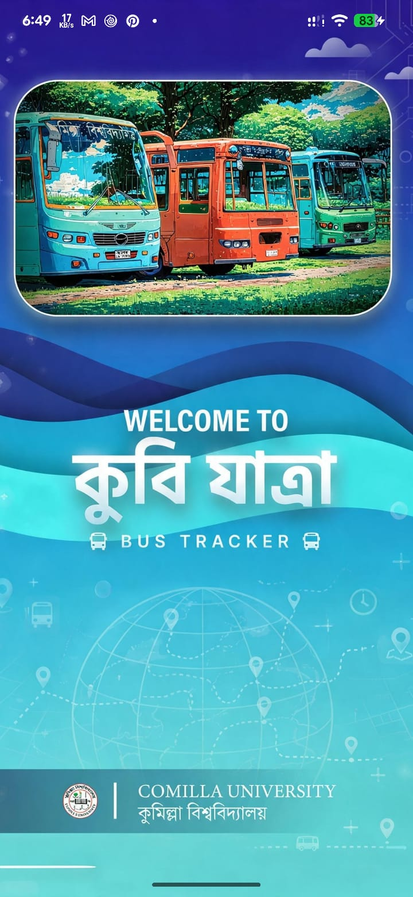

<div align="center">

# 🚌 CoU Bus Tracker (CoU Jatra)
### 🎓 Comilla University Transport Management System

A modern, real-time bus tracking and intelligent transport management solution built with **Flutter** and **Spring Boot 3** for students, teachers, and staff of **Comilla University**.

[](https://flutter.dev)
[](https://dart.dev)
[](https://riverpod.dev)
[](https://spring.io/projects/spring-boot)
[](LICENSE)

</div>

---

## 📱 App Screenshots

<div align="center">

| 🚀 Splash & Cold-Launch | 🏠 Home Dashboard | 📅 Bus Schedules | 🚌 Bus Details |
| :---: | :---: | :---: | :---: |
|  |  |  |  |
| **Splash Screen & Server Warmup** | **Home Dashboard** | **Smart Schedule** | **Bus Details** |

<br/>

| 📍 Live GPS Tracking | 🔐 Phone OTP Verification | 👤 User Profile | ℹ️ About & Credits |
| :---: | :---: | :---: | :---: |
|  |  |  |  |
| **Live GPS Tracking** | **OTP Verification** | **User Profile** | **About Us & Credits** |

</div>

---

## 📋 Table of Contents

- [📱 App Screenshots](#-app-screenshots)
- [📖 About the Project](#-about-the-project)
- [✨ Key Features](#-key-features)
- [🛠️ Tech Stack](#-tech-stack)
- [🏗️ Architecture](#-architecture)
- [📁 Project Structure](#-project-structure)
- [📱 Screens & Navigation](#-screens--navigation)
- [🔐 Authentication & Security](#-authentication--security)
- [🔄 Remote Config & Version Control](#-remote-config--version-control)
- [🌐 API Endpoints](#-api-endpoints)
- [📊 State Management](#-state-management)
- [🎨 Theme & Design System](#-theme--design-system)
- [⚠️ Error Handling](#️-error-handling)
- [💾 Storage & Caching](#-storage--caching)
- [🔧 Interceptor Setup](#-interceptor-setup)
- [📍 Live GPS Tracking](#-live-gps-tracking)
- [🚀 Getting Started](#-getting-started)
- [⚙️ Backend Setup](#-backend-setup)
- [📦 Models](#-models)
- [🧩 Shared Widgets](#-shared-widgets)
- [👨‍💻 Author & Credits](#-author--credits)

---

## 📖 About the Project

**CoU Bus Tracker (CoU Jatra)** is a full-stack transport management solution designed specifically for **Comilla University**. It solves campus transport challenges by providing real-time tracking, intelligent scheduling, and public announcements via a **Bengali-first** localized premium interface.

The app serves three user roles — **Students**, **Teachers**, and **Staff** — with role-based bus filtering, ensuring each user sees only the buses relevant to them. The published packages use the bundle identifier **`com.cse.coubustracker`** on both Android and iOS.

---

## ✨ Key Features

### 📍 Smart Live Tracking
- **Real-time Status Detection**: Automatically identifies if a bus is **চলমান (Moving)** or **থেমে আছে (Stopped)**.
- **Live Distance Calculation**: Shows real-time distance from the user to the bus (e.g., **আপনার থেকে: ৪.৫ কিমি**) using GPS (`Geolocator`).
- **Stylish Dashboard**: Modern floating speedometer and status pulse animations.
- **Platform-aware Map**: Native `WebView` on mobile, HTML iframe on web — both with custom UI cleanup and 5-second refresh injection.

### 📅 Intelligent Scheduling
- **Automatic Day Detection**: Shows relevant schedules based on the current day (working days vs. weekend).
- **Role-Based Filtering**: Students see only student buses (BLUE, RED, STAFF); teachers see only teacher buses (TEACHER, OFFICER).
- **Multiple Filter Views**: Switch between Today's list, Working Days (Sat–Thu), and Weekend (Fri–Sat).
- **Search & Filter**: Find buses by name, time, or route with full search support.
- **Direction Filters**: Filter by **ক্যাম্পাস অভিমুখে** (Campus-bound) or **ক্যাম্পাস থেকে** (Campus-departing) routes.

### 🔐 Secure Authentication (Phone + Password + One-Time OTP)
- **Phone Number Registration & Login**: Registration and login use a Bangladeshi phone number (`01XXXXXXXXX` / `8801XXXXXXXXX` / `+8801XXXXXXXXX` — normalized to `8801XXXXXXXXX`). Password is set at registration.
- **BulkSMSBD OTP**: A 6-digit OTP is delivered by SMS — **only during registration** to verify the phone. OTPs expire after 2 minutes, allow 5 wrong attempts, and a 60-second resend cooldown. The OTP screen features a masked number (`8801****5678`), an auto-submitting 6-box input, and an MM:SS countdown timer.
- **Auto-OTP After Registration**: Registration immediately sends the OTP and parks the user on the verification screen (`/auth/phone-verification/verify`).
- **Phone + Password Login**: Login is done with phone + password only — **no OTP at login** (`/auth/*/login` with `{phone, password}` → JWT). An unverified account auto-routes back to the OTP step.
- **Multipart Registration**: ID card upload with client-side compression to ≤300 KB; the user's phone is used as the placeholder email (`{phone}@cou.bus`) until the backend is fully phone-migrated.
- **Session Validation**: Token verified against backend on every app launch.
- **Auto-Logout**: Automatic logout when admin deletes/rejects a user (401/403 handling).
- **In-App Bengali Errors**:
  - Unregistered phone: `"এই ফোন নম্বরে কোনো ব্যবহারকারী নেই। প্রথমে রেজিস্ট্রেশন করুন।"`
  - Wrong password / phone: `"ফোন নম্বর বা পাসওয়ার্ড সঠিক নয়।"`
  - Deactivated account: `"আপনার অ্যাকাউন্ট নিষ্ক্রিয়। অ্যাডমিনের সাথে যোগাযোগ করুন।"`

### ⚡ Lightning-Fast Performance
- **Local Storage Caching**: Data loads instantly from local storage for zero wait time.
- **Bulk Pre-caching**: Automatically fetches and saves all bus details in the background upon app launch.
- **Background Sync**: Updates cached data silently when internet is available.
- **Offline-First**: App works seamlessly with cached data when backend is unreachable.

### 🔄 Version Control & Maintenance (Server-Driven)
- **Cold-Launch Gate**: On startup the app fetches `/api/config` and decides — enter the app, show a force-update screen, or show a maintenance overlay.
- **In-App Update Check**: A lightweight `/app/version` check pops an update dialog; optional versions offer **"পরে আপডেট করব"** (Update Later) which is remembered.
- **Cache-First Config**: Last known config is applied instantly, then refreshed in the background.

### 🎨 Premium Visuals & UX
- **Stylish Gradients**: Modern 3-tone vertical gradient (Dark Indigo → Vibrant Blue → Bright Cyan).
- **Interactive Animations**: Smooth transitions, scale effects, and heartbeat pulses for live states using `flutter_animate` & `flutter_staggered_animations`.
- **Clean Forms**: Redesigned Role Selection, Login, and Registration pages with modern cards.
- **Bengali-First UI**: User-facing UI labels, error messages, and alerts are presented in Bengali.

---

## 🛠️ Tech Stack

### Frontend (Flutter)
| Package | Version | Purpose |
|---|---|---|
| `flutter_riverpod` | ^2.6.1 | State management |
| `dio` | ^5.7.0 | HTTP client with interceptors |
| `http` | ^1.2.2 | Simple HTTP fallback (`ApiService`) |
| `go_router` | ^14.8.1 | Declarative routing |
| `flutter_secure_storage` | ^9.2.4 | Encrypted storage (tokens) |
| `shared_preferences` | ^2.3.4 | Key-value local storage |
| `package_info_plus` | ^8.1.3 | App version/build info |
| `image_picker` | ^1.1.2 | Camera/gallery image selection |
| `flutter_image_compress` | ^2.5.1 | Client-side image compression |
| `geolocator` | ^13.0.1 | Device GPS location |
| `webview_flutter` | ^4.9.0 | In-app WebView (live tracking) |
| `connectivity_plus` | ^6.1.2 | Network connectivity detection |
| `flutter_animate` | ^4.5.2 | Animation framework |
| `flutter_staggered_animations` | ^1.0.0 | Staggered list animations |
| `badges` | ^3.1.2 | Badge widgets |
| `pointer_interceptor` | ^0.10.1+1 | Pointer passthrough over WebViews |
| `cached_network_image` | ^3.4.1 | Network image caching |
| `google_fonts` | ^6.2.1 | Custom typography (Inter, Plus Jakarta Sans) |
| `shimmer` | ^3.0.0 | Loading shimmer effects |
| `url_launcher` | ^6.3.1 | Open URLs in browser |
| `mime` | ^2.0.0 | MIME type detection |
| `http_parser` | ^4.0.0 | HTTP media type parsing |
| `intl` | any | Internationalization utilities |
| `equatable` | ^2.0.7 | Value equality for models |
| `json_annotation` | ^4.9.0 | JSON serialization annotations |

### Backend (Spring Boot)
- **Java 17+** with Spring Boot 3
- **JWT Authentication** with role-based access control
- **Cloudinary** for image storage
- **BulkSMSBD** for SMS OTP delivery
- **PostgreSQL** database

---

## 🏗️ Architecture

The project follows a **feature-first clean architecture** pattern:

```
lib/
  app/        → Shell layer (routing, theming, localization, global navigation)
  core/       → Infrastructure layer (API client, storage, error handling, constants,
                remote config, version checking)
  features/   → Feature modules, each self-contained:
                  - Screen(s) (UI)
                  - Provider (Riverpod StateNotifier)
                  - Repository (data access, API calls)
  shared/     → Cross-feature layer:
                  - models/   (data classes shared across features)
                  - widgets/  (reusable UI components shared across features)
```

### Key Patterns

- **State Management**: Riverpod with `StateNotifier` + `StateNotifierProvider`
- **Data Flow**: `Screen → Provider → Repository → ApiClient (Dio) → Backend`
- **Result Pattern**: Sealed `Result<T>` class (`Success`, `Failure`, `Loading`, `Empty`) propagates through the repository layer
- **Dependency Injection**: All repositories and infra providers centralized in `lib/features/providers.dart`; `StorageService` is injected from `main.dart` via a provider override
- **Caching**: Every provider loads from local cache first, then refreshes from network
- **Localization**: Bengali-first UI strings with English system fallback

---

## 📁 Project Structure

```
lib/
├── main.dart                    # Entry point; initializes StorageService in ProviderScope
├── app/
│   ├── app.dart                 # MaterialApp.router; session-expiry handling; in-app update check
│   ├── shell_screen.dart        # Bottom navigation shell (4 tabs)
│   ├── router.dart              # GoRouter configuration with all routes
│   └── theme.dart               # Full design system (colors, spacing, typography, dark theme)
├── core/
│   ├── api_client.dart          # Dio client: AuthInterceptor, cold-start retry, sanitized logging
│   ├── api_service.dart         # Plain `http`-based singleton helper (lightweight fallback)
│   ├── update_service.dart      # UpdateService — checks /app/version, exposes UpdateInfo
│   ├── constants.dart           # Base URL, API endpoints, storage keys, timeouts
│   ├── error_handler.dart       # Centralized Bengali error message translation
│   ├── result.dart              # Sealed Result<T> class
│   ├── storage_service.dart     # Dual-storage (SecureStorage + SharedPreferences)
│   ├── config/
│   │   ├── remote_config_service.dart   # PublicConfig + /api/config fetch (cache-first)
│   │   └── app_version_checker.dart     # compareVersions + AppGateStatus evaluation
│   └── utils/
│       └── time_utils.dart      # Time formatting utilities
├── features/
│   ├── providers.dart           # Central provider definitions (repos, ApiClient, config)
│   ├── auth/                    # Role, Login, Register, OTP, Upload ID + auth repository/provider
│   ├── home/                    # Dashboard home screen + aggregation provider
│   ├── buses/                   # Bus list, bus detail, live tracking (mobile/web) + provider
│   ├── schedules/               # Schedule screen + provider + repository
│   ├── notices/                 # Notice screen + provider + repository
│   ├── splash/                  # Splash: config gate, maintenance/force-update screens
│   ├── profile/                 # Profile screen
│   └── about/                   # About Us screen
├── shared/
│   ├── models/                  # 9 data models (+ generated .g.dart)
│   └── widgets/                 # 5 reusable widgets (BusCard, ScheduleCard, StatCard, LiveIndicator, UpdateDialog)
└── assets/
    └── images/                  # App images (logo, splash, developer photos, kubi_jatra_images)
```

---

## 📱 Screens & Navigation

| Route | Screen | Description |
|---|---|---|
| `/splash` | `SplashScreen` | Initial route; fetches config, evaluates app gate (maintenance / force-update / allowed), warms up server |
| `/auth/role` | `RoleScreen` | Role selection (Student / Teacher) |
| `/auth/login` | `LoginScreen` | Phone number + password → JWT (no OTP) |
| `/auth/register` | `RegisterScreen` | Full registration with ID card upload + password |
| `/auth/otp` | `PhoneOtpVerificationScreen` | 6-digit phone OTP (registration phone verification only) |
| `/auth/upload-id` | `UploadIdScreen` | ID card upload helper |
| `/home` | `HomeScreen` | Dashboard with stats, today's schedule, notices |
| `/buses` | `BusListScreen` | Bus directory with role-based category filtering |
| `/schedules` | `ScheduleScreen` | Role-filtered schedule with day/direction filters |
| `/notices` | `NoticeScreen` | Active transport notices |
| `/profile` | `ProfileScreen` | User info, verification status, logout |
| `/bus/:id` | `BusDetailScreen` | Bus detail with embedded schedules |
| `/bus/live/:id` | `LiveTrackingScreen` | WebView (mobile) / HTML iframe (web) GPS tracking map |
| `/about` | `AboutScreen` | Project credits and developer profiles |

---

## 🔐 Authentication & Security

### Registration Flow
1. **Role Selection** → Student or Teacher
2. **Fill Form** → name, phone, ID, department, batch/designation, and a chosen **password** (+ confirm)
3. **ID Card Upload** → Pick from gallery, auto-compress to ≤300 KB (an admission form is accepted when the ID card isn't available yet)
4. **Form Submission** → Multipart/form-data with name, phone, password, ID, department, batch/designation + image. Phone is used as placeholder email (`{phone}@cou.bus`).
5. **SMS OTP** → 6-digit code sent to the phone via BulkSMSBD (2-minute expiry, 5 attempts, 60s resend cooldown) — **OTP is only sent during registration**
6. **Verification** → Enter OTP on the auto-submitting 6-box screen → Account activated

### Login Flow (Phone + Password — no OTP)
1. **Role Selection** → Student or Teacher
2. **Phone Number** → enter `01XXXXXXXXX` (validated + normalized to `8801XXXXXXXXX`)
3. **Password** → the password chosen during registration
4. **Login** → `/auth/*/login` with `{phone, password}` returns a JWT. If the phone was never OTP-verified, the app auto-routes to the OTP step.
5. **Token Storage** → JWT stored in encrypted `FlutterSecureStorage`
6. **Session Validation** → Token verified against backend on every app launch

### Session Security & Error Messages
- **Token Validation**: Profile endpoint called on startup to verify token validity
- **Auto-Logout**: Dio interceptor catches 401/403 **only when the request carried an auth token** → clears all data → shows an expired-session SnackBar → navigates to role screen
- **User-Facing App Error Strings**:
  - Unregistered phone: `"এই ফোন নম্বরে কোনো ব্যবহারকারী নেই। প্রথমে রেজিস্ট্রেশন করুন।"`
  - Wrong credentials: `"ফোন নম্বর বা পাসওয়ার্ড সঠিক নয়।"`
  - Deactivated account: `"আপনার অ্যাকাউন্ট নিষ্ক্রিয়। অ্যাডমিনের সাথে যোগাযোগ করুন।"`
  - Expired session: `"সেশন শেষ হয়েছে। আবার সাইন ইন করুন।"`
- **Admin Deletion**: When admin deletes/rejects a user, next API call triggers automatic logout
- **No Duplicate Requests**: Retry interceptor never retries POST/PUT/DELETE

---

## 🔄 Remote Config & Version Control

The app is driven by **server-side configuration** at cold launch via `GET /api/config`:

| Field | Purpose |
|---|---|
| `latestAppVersion` | Newest published version |
| `minimumAppVersion` | Hard floor — below this forces an update |
| `forceUpdate` | When `true`, below-latest versions are treated as mandatory |
| `updateMessage` | Message text shown on the update screen |
| `playStoreUrl` | Play Store link for the install |
| `maintenanceMode` | When `true`, the whole app is replaced by the maintenance screen |
| `maintenanceMessage` | Message text shown during maintenance |

---

## 🌐 API Endpoints

**Base URL**: `https://cou-bus-tracker-backend-admin-frontend.onrender.com/api`

| Endpoint | Method | Description |
|---|---|---|
| `/config` | GET | Public app config (versions, maintenance, updates) |
| `/app/version` | GET | Newest build + optional download info |
| `/buses` | GET | List all buses |
| `/buses/{id}` | GET | Bus detail with schedules |
| `/schedules` | GET | List all schedules |
| `/schedules/bus/{busId}` | GET | Schedules for a specific bus |
| `/notices/active` | GET | Active notices |
| `/auth/student/register` | POST | Student registration (multipart) |
| `/auth/teacher/register` | POST | Teacher registration (multipart) |
| `/auth/student/login` | POST | Student login with phone + password → JWT |
| `/auth/teacher/login` | POST | Teacher login with phone + password → JWT |
| `/auth/phone-verification/send` | POST | Send SMS OTP `{phone, role}` |
| `/auth/phone-verification/verify` | POST | Verify OTP `{phone, role, otp}` → JWT |
| `/auth/phone-verification/resend` | POST | Resend SMS OTP `{phone, role}` |
| `/auth/student/me` | GET | Student profile (token validation) |
| `/auth/teacher/me` | GET | Teacher profile (token validation) |
| `/auth/student/upload-id-card` | POST | Upload student ID card |
| `/auth/teacher/upload-id-card` | POST | Upload teacher ID card |

---

## 📊 State Management

### Central Providers (`lib/features/providers.dart`)

| Provider | Type | Purpose |
|---|---|---|
| `storageServiceProvider` | `Provider<StorageService>` | Root-level storage injection (overridden in `main.dart`) |
| `remoteConfigServiceProvider` | `Provider<RemoteConfigService>` | `/api/config` fetch + cache |
| `updateServiceProvider` | `Provider<UpdateService>` | `/app/version` update checks |
| `apiClientProvider` | `Provider<ApiClient>` | Singleton Dio client |
| `busRepositoryProvider` | `Provider<BusRepository>` | Bus API calls |
| `scheduleRepositoryProvider` | `Provider<ScheduleRepository>` | Schedule API calls |
| `noticeRepositoryProvider` | `Provider<NoticeRepository>` | Notice API calls |
| `authRepositoryProvider` | `Provider<AuthRepository>` | Auth API calls |

---

## 🎨 Theme & Design System

### Colors
| Name | Hex | Usage |
|---|---|---|
| `primaryBlue` | `#3886D8` | Primary brand color |
| `secondaryBlue` | `#5BA4FB` | Secondary accent |
| `primaryDark` | `#2C6BB1` | Darker variant |
| `accentBlue` | `#E1EBFD` | Light accent backgrounds |
| `backgroundLight` | `#F6F9FE` | Scaffold background (light theme) |
| `backgroundDark` | `#0F172A` | Scaffold background (dark theme) |
| `surfaceLight` | `#FFFFFF` | Card surfaces |
| `textPrimary` | `#1E293B` | Primary text |
| `textSecondary` | `#64748B` | Secondary text |
| `textHint` | `#94A3B8` | Hint text |
| `successGreen` | `#10B981` | Success states |
| `warningAmber` | `#F59E0B` | Warning states |
| `errorRed` | `#EF4444` | Error states |

---

## ⚠️ Error Handling

### HTTP Status Code Mapping Table

| Status Code | In-App Displayed Bengali Message | Description / Cause |
| :---: | :--- | :--- |
| **400** | `তথ্য সঠিক নয়। আবার চেষ্টা করুন।` | Invalid parameters or request body format. |
| **401** | `সেশন শেষ হয়েছে। আবার সাইন ইন করুন।` *(Login: `ফোন নম্বর বা পাসওয়ার্ড সঠিক নয়।`)* | Expired session token or invalid login credentials. |
| **403** | `অনুমতি নেই।` | Action forbidden for the user role. |
| **404** | `তথ্য পাওয়া যায়নি।` | Requested resource or endpoint does not exist. |
| **409** | `এই ফোন নম্বর ইতিমধ্যে ব্যবহৃত হচ্ছে।` | Phone number is already registered. |
| **500** | `সার্ভারে সমস্যা। পরে আবার চেষ্টা করুন।` | Internal backend exception. |
| **502/503/504** | `সার্ভার চালু হচ্ছে বা সাময়িকভাবে ব্যস্ত। ১–২ মিনিট পরে আবার চেষ্টা করুন।` | Server cold-starting or temporarily busy. |

### Dynamic Backend Error String Mapping (`friendly()`)

| Backend Error String Pattern | In-App Displayed Message |
| :--- | :--- |
| `"invalid otp"` / `"incorrect otp"` / `"wrong otp"` | **`ভুল OTP। আবার চেষ্টা করুন।`** |
| `"not found with this phone"` / `"no user found"` | **`এই ফোন নম্বরে কোনো ব্যবহারকারী নেই। প্রথমে রেজিস্ট্রেশন করুন।`** |
| `"verify your phone"` / `"phone is not verified"` | **`অনুগ্রহ করে লগইন করার আগে আপনার ফোন নম্বর যাচাই করুন।`** |
| `"invalid credentials"` / `"wrong password"` | **`ফোন নম্বর বা পাসওয়ার্ড সঠিক নয়।`** |
| `"deactivated"` / `"account is inactive"` | **`আপনার অ্যাকাউন্ট নিষ্ক্রিয়। অ্যাডমিনের সাথে যোগাযোগ করুন।`** |
| `"already registered"` / `"already exists"` | **`এই ফোন নম্বর ইতিমধ্যে ব্যবহৃত হয়েছে।`** |
| `"register first"` / `"not registered"` | **`আপনার অ্যাকাউন্ট পাওয়া যায়নি। আগে নিবন্ধন করুন।`** |

---

## 💾 Storage & Caching

### Dual-Storage Architecture

**FlutterSecureStorage** (encrypted):
- `access_token` — JWT token
- `token_type` — Bearer token type
- `pending_verification_phone` — Phone awaiting OTP verification
- `pending_verification_role` — Role awaiting OTP verification

**SharedPreferences** (plain):
- `user_role`, `display_name`, `user_email`, `user_phone`, `user_id`
- `is_verified`, `is_edu_mail`
- `_has_token` — Boolean flag for quick auth check
- `theme_mode`, `language_code`
- `cached_buses`, `cached_schedules`, `cached_notices`, `cached_bus_detail_{id}` — JSON string caches
- `super_admin_config` — Cached remote config (from `/api/config`)
- `skipped_version` — Version the user chose to skip

---

## 🔧 Interceptor Setup

Three interceptors are configured on the Dio instance:

1. **AuthInterceptor**: Injects `Authorization: Bearer` token to private endpoints and handles 401/403 auto-logout safely.
2. **RetryOnColdStartInterceptor**: Retries idempotent GET/HEAD requests with exponential backoff to handle Render free-tier cold starts.
3. **LogInterceptor**: Sanitized, secure logging without sensitive token or password exposure.

---

## 📍 Live GPS Tracking

The live tracking screen adapts to the platform (`live_tracking_conditional.dart` via conditional exports):

- **Mobile** (`live_tracking_mobile.dart` + `webview_flutter`): Full-screen `WebViewController` with custom CSS injection, 5-second refresh interval, and real-time speed & distance tracking.
- **Web** (`live_tracking_web.dart` + `HtmlElementView`): Registers an `<iframe>` platform view, cropped and centered for map visibility.
- **Offline Overlay**: Displays **`ইন্টারনেট সংযোগ নেই`** (No Internet Connection) with a retry option if network connection drops.

GPS distance uses `Geolocator.distanceBetween` between device position and the bus coordinates.

---

## 🚀 Getting Started

### Prerequisites
- Flutter SDK with Dart 3.8+
- Spring Boot backend running (see [Backend Setup](#-backend-setup))

### Installation

1. **Clone the repo**:
   ```bash
   git clone https://github.com/your-username/cou_bus_tracker.git
   cd cou_bus_tracker
   ```

2. **Install dependencies**:
   ```bash
   flutter pub get
   ```

3. **Configure API**:
   The backend base URL is defined in `lib/core/constants.dart`:
   ```dart
   const String kBaseUrl =
       'https://cou-bus-tracker-backend-admin-frontend.onrender.com';
   ```

4. **Run the App**:
   ```bash
   flutter run
   ```

### Build Release Artifacts

```bash
# Android APK (package id: com.cse.coubustracker)
flutter build apk --release

# iOS App Bundle (bundle id: com.cse.coubustracker)
flutter build ios --release

# Web Deployment
flutter build web --release
```

---

## ⚙️ Backend Setup

The backend is a **Spring Boot 3** application with:
- **Java 17+**
- **Spring Security** with JWT authentication
- **PostgreSQL** database
- **Cloudinary** for image storage
- **BulkSMSBD** — SMS OTP delivery service

---

## 📦 Models

| Model | Fields | Description |
|---|---|---|
| `AuthResponse` | accessToken, tokenType, role, id, name, email, phone, isVerified, isEmailVerified, isPhoneVerified, isEduMail | Auth response from all endpoints |
| `Bus` | id, busNumber, busName, category, route, driverName, driverPhone, busImageUrl, trackerUrl, isActive | Bus entity |
| `BusDetail` | extends Bus + schedules | Bus with embedded schedules |
| `Schedule` | id, busId, busNumber, busName, category, departureTime, arrivalTime, direction, startPoint, endPoint, days | Schedule entity |
| `Notice` | id, title, body, isActive, createdAt, expiresAt | Notice entity |
| `Student` | id, name, email, studentId, department, varsityBatch, idCardImageUrl, isEduMail, isVerified, isActive, createdAt | Student profile |

---

## 🧩 Shared Widgets

| Widget | Description |
|---|---|
| `BusCard` | Bus card with category color coding, bus number, route, and live indicator |
| `ScheduleCard` | Schedule card with direction badge, route display, and formatted time |
| `StatCard` | Dashboard stat card with animated counter and icon |
| `LiveIndicator` | Green pulsing dot indicating real-time tracking availability |
| `UpdateDialog` | Update prompt with force/optional modes, Play Store launch, and skip memory |

---

## 👨‍💻 Author & Credits

<div align="center">

**Developed by Md. Tareq Hasan**  
*Dept. of Computer Science & Engineering (Batch 16)*  
**Comilla University**  

*Project Consultant:* **Raihan Khan** *(Dept. of CSE, Batch 10)*  

---

© 2026 **CoU Bus Tracker**. All rights reserved.

</div>
